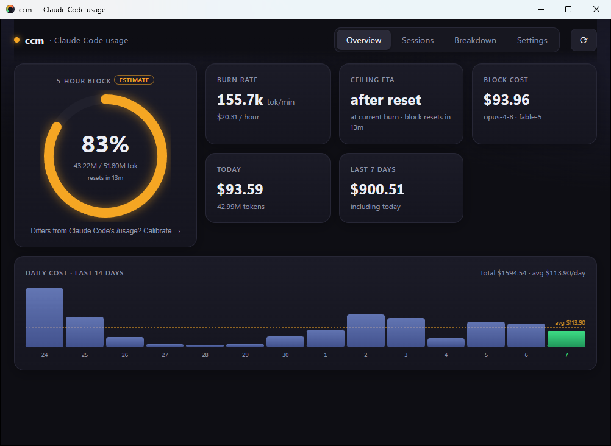
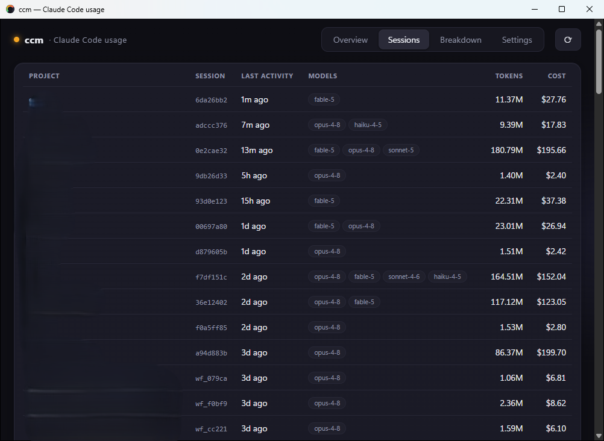
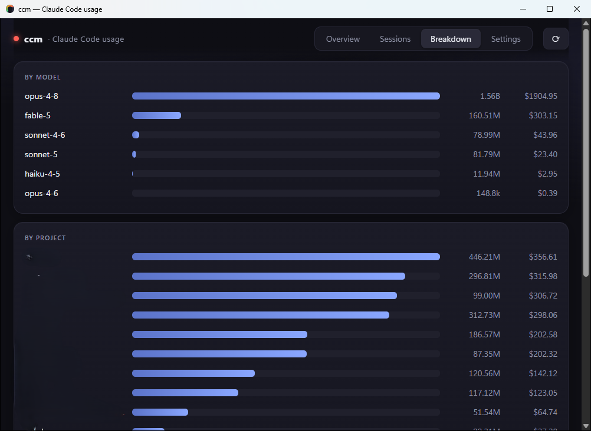
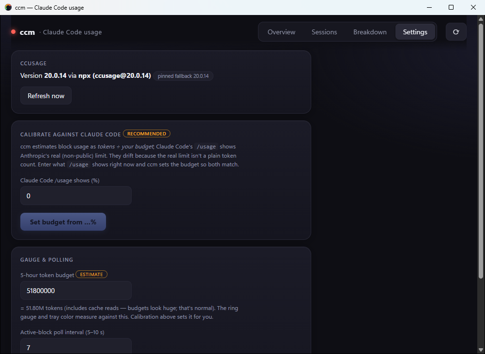

# ccm — Claude Code Monitor

A local, personal **Windows desktop app** that shows how close you are to your Claude
5-hour usage limit without opening a terminal: a live dashboard plus a color-coded
system-tray gauge. Built with **Tauri v2 (Rust)** + **SvelteKit**.

All data comes from the [ccusage](https://github.com/ryoppippi/ccusage) CLI. ccm never
reads `~/.claude` itself.

```
Claude Code ──writes──▶ ~/.claude/projects/**/*.jsonl
                             │
                   ccusage claude <cmd> --json     (parsing · pricing · block inference)
                             │
     Rust (src-tauri): 2 timers spawn ccusage ──events──▶ SvelteKit dashboard
                             │                                │
                             └───────── updates ─────────────▶ tray icon + tooltip
```

## Screenshots

| Overview — live block gauge, burn rate, ETA, daily-cost chart | Sessions — per-session tokens & cost |
|---|---|
|  |  |

| Breakdown — by model / project, cache vs fresh | Settings — calibration, budget, intervals |
|---|---|
|  |  |

## Quick start

```sh
npm install
npm run tauri dev     # dev build; opens the window, tray icon appears
```

First run checklist:

1. **Rust toolchain** — rustup (stable MSVC) + Visual Studio "Desktop development with
   C++" build tools. WebView2 ships with Win11. (Both already installed on this machine.)
2. **ccusage** — nothing to do: ccm finds `ccusage` on PATH or falls back to
   `npx -y ccusage@20.0.14` (first npx call is slow while it downloads).
3. **Calibrate the gauge** — Settings → *Calibrate against Claude Code*: enter the % that
   Claude Code's `/usage` shows and ccm sets your token budget so both match.

Release build: `npm run tauri build` → NSIS installer in `src-tauri/target/release/bundle/`.
Tests: `cargo test --manifest-path src-tauri/Cargo.toml` (gauge math).

## The views

| View | Shows |
|---|---|
| **Overview** | Ring gauge (% of your 5-hour budget, labeled *estimate*), burn rate (tok/min, $/h), ETA-to-ceiling forecast, block cost, today + last-7-days cost, 14-day daily-cost chart |
| **Sessions** | Recent sessions: project, session id, last activity, models, tokens, cost |
| **Breakdown** | Cost/tokens by model, by project, and cache-vs-fresh token split (today + all history) |
| **Settings** | ccusage version + source, calibration, token budget, poll intervals |

**Tray:** green / amber / red dot (< 60% / 60–85% / ≥ 85% of budget; grey = no active block
or error) with tooltip `"58% of 5h block · ~1h 12m left · $3.40 today"`. Left-click toggles
the window, right-click gives Open / Refresh / Quit. **Closing the window hides to tray —
Quit is what exits.**

## Design decisions

### 1. Wrap ccusage; never parse `~/.claude`

The fragile, high-maintenance work — parsing the undocumented `.jsonl` format, keeping the
per-model pricing table current, inferring 5-hour billing blocks — is exactly what ccusage
already does, maintained by someone else. ccm consumes its `--json` output and builds only
UI. Format drift, price changes, and block math are ccusage's problem forever.

Consequence: the ccusage version is **pinned** (`PINNED_VERSION` in
[src-tauri/src/ccusage.rs](src-tauri/src/ccusage.rs), currently **20.0.14**) so the JSON
schema is stable. Bump deliberately and re-verify the shapes of the three commands below.

### 2. Use the `claude`-scoped ccusage commands

ccusage v20 became a multi-agent tool: top-level `ccusage daily` merges Codex, Gemini,
etc. into the same rows — wrong data for a *Claude* monitor. The scoped commands ccm runs:

| Command | Poll | Feeds |
|---|---|---|
| `ccusage claude blocks --active --json` | every 5–10 s | gauge, tray, burn rate, ETA |
| `ccusage claude daily --json` | every 30–60 s | today/week cost, model breakdown, chart |
| `ccusage claude session --json` | every 30–60 s | Sessions view, project breakdown |

Field shapes were verified against real output of the pinned version (the scoped reports
also differ structurally: `daily` rows use `date`, session rows carry `projectPath` —
neither is true of the top-level commands).

### 3. The gauge ceiling is user-set, and labeled an estimate

There is **no API for plan-limit consumption**. ccusage measures token *usage*; only
Anthropic knows the actual limit, and it is not a plain token count. So:

- Settings holds a **5-hour token budget**; gauge % = `activeBlock.totalTokens / budget`.
- **Calibration** closes the gap pragmatically: you enter the % Claude Code's `/usage`
  shows right now, ccm back-solves `budget = used / pct`. The two drift over time
  (different metrics), so recalibrate occasionally.
- The UI says *estimate* everywhere rather than pretending precision it can't have.
- Token counts include cache reads, so budgets look huge (tens of millions). Normal.

### 4. Rust owns the math; the frontend gets both numbers and raw JSON

`GaugeState` (percent, burn rate, ETA, block-remaining) is computed once in Rust
([gauge.rs](src-tauri/src/gauge.rs), pure functions, unit-tested) because the **tray is
Rust-owned** — computing it in the webview would mean two implementations that disagree.
The raw ccusage JSON is forwarded to the frontend untouched for everything display-only
(tables, breakdowns), parsed defensively there. Typed Rust structs exist only where math
happens; everything else stays `serde_json::Value` so schema drift in fields we don't
compute on can't break the app.

Burn-rate fallback: prefer ccusage's `burnRate.tokensPerMinute`; if absent, derive
`used / elapsed` from the block's `startTime`.

### 5. Two timers, not one; wake-early refresh

Fast loop (5–10 s) for the active block — the thing you glance at. Slow loop (30–60 s) for
daily/session reports — nothing there changes fast, and each poll spawns a process.
"Refresh now" doesn't restart timers; each loop sleeps in
`tokio::time::timeout(interval, Notify::notified())`, so a refresh just wakes both loops
instantly. Intervals are read from settings every cycle, so changes apply without restart.

### 6. Windows-safe spawning

npm installs `ccusage` as a `.cmd` shim and `npx` itself is `npx.cmd` — neither spawns
directly from `CreateProcess`. So every invocation goes through `cmd /C`, with
`CREATE_NO_WINDOW` (0x08000000) so a console doesn't flash on every poll. Detection runs
once and is cached: try `ccusage --version` on PATH, else `npx -y ccusage@<pinned>`;
stdout is parsed from the first `{` because npm sometimes prefixes notices.

### 7. Tray: three prebuilt dots, not a rendered gauge

The color band **is** the signal — green/amber/red/grey PNGs are generated once
([icons/gen-icons.mjs](src-tauri/icons/gen-icons.mjs), dependency-free Node script that
writes the PNGs and the `.ico` byte-by-byte) and bundled via `include_bytes!`. No runtime
icon rendering, no numeric tray badges (fiddly on Windows, unreadable at 16px). Detail
lives in the tooltip.

### 8. Events push, snapshot pulls

Rust emits `ccm://active-block` (gauge + raw block), `ccm://usage` (daily + sessions),
`ccm://error`. Events fired before the webview mounts would be lost, so the frontend also
calls a `get_snapshot` command on startup to seed from the Rust-side cache, then listens.
Commands: `get_settings` / `set_settings` / `refresh_now` / `ccusage_status` /
`get_snapshot`.

### 9. Deliberately not built

- **No chart library** — the ring gauge is one SVG circle with `stroke-dashoffset`; bars
  are divs. layerchart/chart.js would be dependencies for two shapes.
- **No database / disk cache** — the local files + ccusage *are* the store. Cold start
  shows data within one poll (~seconds).
- **No hosted backend, accounts, auth, OTel** — local, single-user, v1. (OTel via
  `CLAUDE_CODE_ENABLE_TELEMETRY=1` + a tiny OTLP receiver is the staged upgrade path if
  polling ever proves insufficient.)
- **No cross-platform polish** — Windows-first; Tauri makes mac/Linux near-free later.
- **Never panic on data** — spawn failures and bad JSON become `ccm://error` + a grey
  tray + a banner; missing data renders empty states. The app must survive "ccusage not
  found" and "no data yet" indefinitely.

### 10. Settings via tauri-plugin-store

One JSON file (`settings.json` in app data) holding budget + intervals. A store file, not
a DB. Values are clamped in Rust (`5–10 s`, `30–60 s`, budget ≥ 1) regardless of what the
frontend sends.

## Project structure

```
ccm/
  src/                        # SvelteKit frontend (Svelte 5 runes, TS)
    routes/+page.svelte       #   header, tabs, error banner
    lib/state.svelte.ts       #   $state store: event listeners + snapshot seed
    lib/Overview.svelte       #   ring gauge, stat cards, 14-day cost chart
    lib/Sessions.svelte       #   sessions table
    lib/Breakdown.svelte      #   model/project bars, cache-vs-fresh split
    lib/SettingsView.svelte   #   status, calibration, budget, intervals
    lib/fmt.ts                #   number/date/color formatting helpers
    app.css                   #   the whole design system (no CSS framework)
  src-tauri/
    src/main.rs               # setup, poll loops, tray, commands, close-to-tray
    src/ccusage.rs            # Windows-safe spawn + detection + JSON parse
    src/gauge.rs              # pure burn-rate/ETA/band math + unit tests
    icons/gen-icons.mjs       # regenerates tray dots + placeholder icon.ico
    tauri.conf.json           # window, NSIS bundle, vite dev URL (:1420)
    capabilities/default.json # core:default only (events + invoke)
  docs/build-spec.md          # original design spec this app was built from
```

## SETUP REQUIRED (remaining)

- **Real app icon** — `src-tauri/icons/icon.ico` is a generated placeholder dot. Replace
  with branding: `npm run tauri icon <1024.png>`.
- **Code signing** — the NSIS installer is unsigned; configure
  `bundle.windows.certificateThumbprint` in `tauri.conf.json` before distributing.
- **ccusage version bumps** — edit `PINNED_VERSION`, re-run the three `--json` commands,
  and diff the field names ccm uses (`gauge.rs` structs, `Overview/Sessions/Breakdown`).

## Troubleshooting

| Symptom | Cause / fix |
|---|---|
| `cargo metadata ... program not found` | Rust not on PATH — install rustup, or restart the shell that predates the install |
| vite: port 1420 in use | Another `tauri dev` instance is running — Quit it from the tray first (`strictPort` is deliberate: Tauri points at a fixed dev URL) |
| Gauge stuck at "no active block" | No Claude usage in the current 5-hour window — use Claude Code, then wait one poll |
| First data takes ~10 s+ | `ccusage` not installed globally, so the first `npx` call downloads it — `npm i -g ccusage` to skip that |
| Gauge % ≠ Claude Code `/usage` % | Expected — recalibrate in Settings (decision #3) |
| App "closed" but still running | Close hides to tray by design; right-click the tray dot → Quit |
